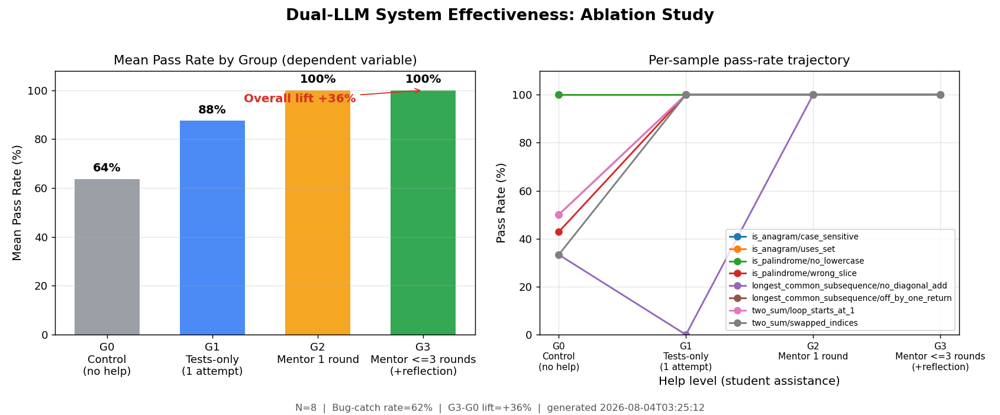

# Dual-LLM Code Tutoring System

**An adversarial dual-LLM pipeline that grades student code, generates its own unit tests, and forces reflection when the student's solution fails them.**


[](https://www.python.org/)
[](LICENSE)
[](https://www.deepseek.com/)

Most "AI code review" tools are a single prompt wrapped in a chat box: the model says something plausible, and nobody checks whether it is *right*. This project treats that as the core problem. Two LLMs are placed in an **adversarial** arrangement — one writes executable tests, the other coaches the student through the failure — so every piece of feedback is anchored to a test that actually ran.

---

## Author & Contribution

**Author:** Daniel Zhao ([@Danielyhzhao](https://github.com/Danielyhzhao)) — sole author, responsible for the full lifecycle:

| Stage | What I did |
|---|---|
| Problem framing | Reframed "AI code feedback" from a single-prompt task into a verifiable adversarial loop |
| System design | Designed the 4-stage pipeline (examiner → test runner → mentor → reflection gate) and the backend abstraction |
| Implementation | ~2,000 lines of Python + a Flask/vanilla-JS web UI; dual-key management, output parsers tolerant of real LLM format drift |
| Evaluation | Built the pilot study harness: 4 problems × 2 bug variants × 4 assistance levels, and the metrics that score them |
| Analysis | Ran the ablation, wrote up the results and their limitations (see [Evaluation](#evaluation)) |

This repository is the public, runnable form of the project. A short code walkthrough is in [`dualllmv2/docs/code_walkthrough.html`](dualllmv2/docs/code_walkthrough.html).

---

## Evaluation

The system ships with a reproducible pilot study. Each of 4 classic algorithm problems (two-sum, palindrome, anagram, LCS) has **two hand-written bug variants**, giving 8 samples. Every sample is run under 4 assistance levels:

| Group | Help given to the student | Mean pass rate |
|---|---|---|
| **G0** | Control — no help | 63.7% |
| **G1** | Examiner's tests only | 87.5% |
| **G2** | Tests + mentor, 1 reflection round | **100%** |
| **G3** | Tests + mentor, up to 3 reflection rounds | **100%** |

**Overall lift: +36.3 percentage points (G3 vs G0).** Bug-catch rate of the generated tests: **62.5%** (5/8 variants; the 3 missed variants are listed below).



Per-sample data: [`dualllmv2/test/results/study_results.csv`](dualllmv2/test/results/study_results.csv) · Aggregates: [`summary_study.json`](dualllmv2/test/results/summary_study.json)

### What the numbers do *not* say

Being explicit about this is part of the work:

- **N = 8.** This is a pilot, not a benchmark. The 100% ceiling at G2 already suggests a task set that is too easy to separate G2 from G3.
- **The 3 undetected variants** (`is_anagram/case_sensitive`, `is_anagram/uses_set`, `is_palindrome/no_lowercase`) share a pattern: the bug only appears on inputs the examiner never thought to generate. Test *generation* quality — not test *execution* — is the binding constraint.
- **One regression is visible**: on `LCS/no_diagonal_add`, tests-only (G1) scored 0.00 where the control scored 0.33, while the mentor groups recovered to 1.00. A bad generated test can actively mislead; mentor framing is what absorbs it.
- Results were collected with the offline rule engine for reproducibility. API-backed runs are supported but not yet systematically benchmarked.

---

## How it works

```text
Student code + problem statement
       │
       ▼
┌──────────────────┐
│  LLM-1 Examiner  │  emits ISSUES + executable unittest cases
│  (DeepSeek API)  │
└──────────────────┘
       │
       ▼
┌──────────────────┐
│  unittest runner │  runs the generated tests, captures failures
└──────────────────┘
       │
       ▼
┌──────────────────┐
│  LLM-2 Mentor    │  reads the *failures* (not the code alone) and writes
│  (DeepSeek API)  │  SUGGESTIONS + a REFLECTION prompt
└──────────────────┘
       │
       ▼
 Student reflects ──► re-run (max 3 rounds) ──► final report
```

The design decision that matters: **LLM-2 never sees a pass/fail verdict it did not earn.** It is conditioned on machine-verifiable test output, which keeps its advice grounded instead of speculative.

---

## Features

- **Adversarial loop, not a single prompt** — feedback is gated on tests that actually executed.
- **Pluggable backends** — `api` (real DeepSeek, two independent keys) or `offline` (local rule engine, no key required, fully reproducible).
- **Tolerant parsers** — handles Markdown fence drift, header variants, and malformed sections in real LLM responses rather than crashing.
- **Interactive web UI** — Flask + vanilla HTML/CSS/JS; watch each iteration's issues, test results, and mentor feedback stream in.
- **No key leakage** — the UI shows only `LLM1·connected`; keys are masked at the config layer and never appear in prompt/response traces.
- **Reproducible evaluation** — the pilot study harness and its data are in the repo.

---

## Project Structure

```text
Dual_LLM/
├── LICENSE
├── README.md
├── agentflow/                     # earlier single-LLM prototype (kept for history)
└── dualllmv2/                     # the current system
    ├── assets/screenshot.png
    ├── docs/
    │   └── code_walkthrough.html  # annotated code walkthrough
    ├── test/                      # reproducible pilot study
    │   ├── README.md
    │   ├── run_experiment.py      # experiment driver (offline or API)
    │   ├── run_study.py           # 4-group ablation driver
    │   ├── problems/              # 4 problems, each with bug variants
    │   └── results/               # chart + CSV + summary (committed)
    ├── web/
    │   ├── app.py                 # Flask backend
    │   └── templates/index.html   # frontend
    ├── config.py                  # config loading, dual-key management, masking
    ├── llm_backends.py            # APIBackend / RuleEngineBackend
    ├── pipeline.py                # the adversarial loop
    ├── parsers.py                 # LLM output parsers
    ├── prompts.py                 # LLM-1 / LLM-2 prompt templates
    ├── utils.py                   # syntax check, unittest execution
    ├── metrics.py                 # scoring metrics
    ├── main.py                    # CLI entry point
    ├── requirements.txt
    └── .env.example
```

---

## Quick Start

All commands below run from inside `dualllmv2/`.

### 1. Install

```bash
python -m venv .venv && source .venv/bin/activate   # Windows: .venv\Scripts\activate
pip install -r requirements.txt
```

Requires Python 3.10+.

### 2. Configure

```bash
cp .env.example .env
```

```env
DUAL_LLM_BACKEND=api        # or "offline" to run with no key at all
LLM1_API_KEY=sk-your-llm1-key-here
LLM2_API_KEY=sk-your-llm2-key-here
LLM1_MODEL=deepseek-chat
LLM2_MODEL=deepseek-chat
```

Two independent keys are recommended so the two roles are genuinely separate calls.

> **Security:** `.env` is gitignored. Never `git add -f .env`.

### 3. Run

```bash
python web/app.py      # web UI at http://localhost:5000
python main.py         # CLI demo
```

### 4. Reproduce the study

```bash
cd test
python run_study.py    # writes runs/ and metrics/; compare with results/
```

Runs offline by default — no API key needed to verify the numbers above.

---

## Limitations & Next Steps

- **Test generation is the bottleneck**, not test execution. Constraining the examiner to a coverage checklist (boundary values, empty input, type edge cases) is the obvious next experiment.
- **Single-domain evaluation** — 4 algorithmic problems. Extending to real submissions (multi-file, library dependencies) is untested.
- **No student-facing longitudinal data** — the study measures pass rate, not learning retention over time. That would need a within-subject design.
- **API latency** — two sequential LLM calls per round; the mentor stage dominates wall-clock time.

---

## License

MIT — see [LICENSE](LICENSE).
